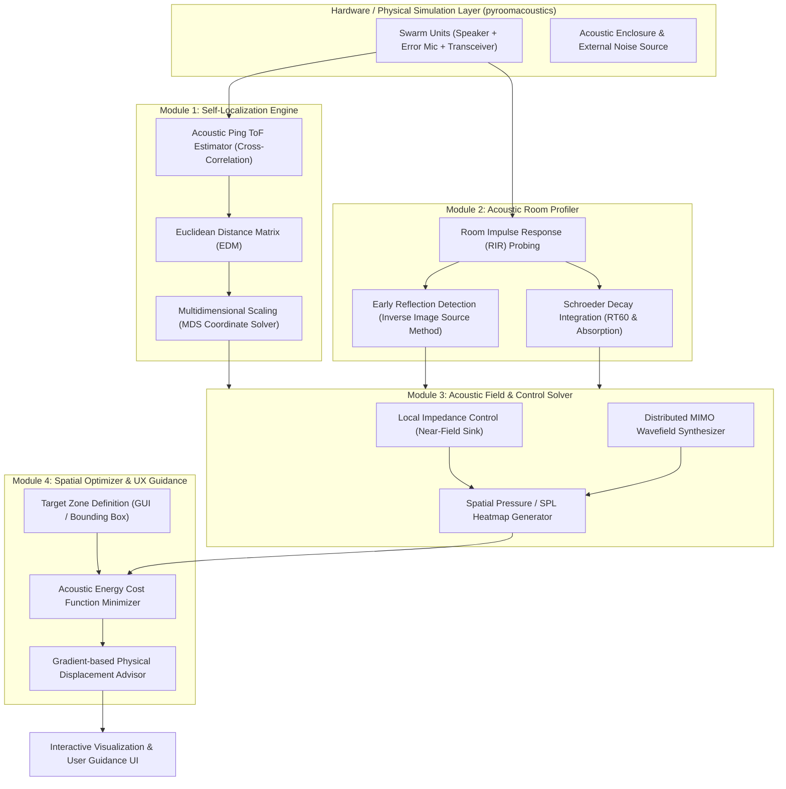
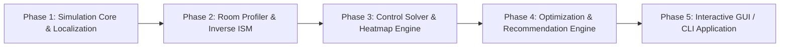

# Swarm Acoustic Active Noise Control (Swarm-ANC): System Architecture & Implementation Plan

## 1. Project Overview & Executive Summary

The **Swarm-ANC** project aims to design and implement a decentralized, self-calibrating acoustic active noise cancellation (ANC) system composed of autonomous, modular absorber/canceller units. 

The system operates across four primary operational pillars:
1. **Self-Localization**: Units perform ultrasound/high-frequency time-of-flight (ToF) acoustic pinging to reconstruct their mutual 2D/3D relative positions without external tracking.
2. **Room Acoustic Characterization & Echolocation**: Units emit probing chirps to detect early room reflections, reconstruct room dimensions, evaluate reverberation time ($RT_{60}$), and identify modal resonance frequencies.
3. **Decentralized Acoustic Wavefield Control**: Units establish active impedance boundaries (e.g. at open windows or aperture barriers) or coordinated beamforming to cancel incoming traffic and environmental noise.
4. **Interactive Spatial Optimizer & Placement Feedback**: The system simulates room acoustic energy distribution, allows the user to designate a "Priority Quiet Zone" (e.g., bed, desk), and computes optimization gradients to guide the user on the optimal physical rearrangement of the units.

---

## 2. System Architecture

---

## 3. Detailed Subsystem Specifications

### Module 1: Swarm Self-Localization (`swarm_localization.py`)
* **Objective**: Determine relative coordinates $[x_i, y_i, z_i]$ for all $N$ units.
* **Physics & Math**:
  * Emits bandpass chirp $s(t)$ ($18\text{ kHz} - 22\text{ kHz}$) from speaker $i$.
  * Microphones $j \neq i$ record $r_j(t)$.
  * Time-of-Arrival (ToA): $\tau_{ij} = \arg\max_\tau (s \star r_j)(\tau)$.
  * Distance: $D_{ij} = c \cdot \tau_{ij}$, where $c = 331.3 \sqrt{1 + T/273.15}\text{ m/s}$.
  * **Coordinate Reconstruction**: Classical Multidimensional Scaling (MDS) solves:
    $$\min_{\mathbf{X}} \|\mathbf{D} - \text{dist}(\mathbf{X})\|_F$$
  * Alignment: Rigid body transform with Unit 1 pinned as origin $[0, 0]$ and Unit 2 defining the x-axis.

### Module 2: Room Geometry & Property Estimation (`room_profiler.py`)
* **Objective**: Infer wall boundaries $[L_x, L_y, L_z]$ and boundary reflection coefficients $\alpha$.
* **Physics & Math**:
  * Probing signal emitted into the interior volume.
  * Extract $RIR(t)$ using deconvolution / cross-correlation with MLS.
  * **$RT_{60}$ Calculation**: Backward Schroeder Integration:
    $$E(t) = \int_t^\infty [RIR(\tau)]^2 d\tau \implies T_{60} \text{ derived from slope between } -5\text{ dB and } -35\text{ dB}$$
  * **Wall Detection (Inverse ISM)**:
    * Identify first-order reflection peaks $t_k$.
    * Intersection of reflection ellipsoids corresponding to speaker-microphone pairs identifies tangent wall planes.
  * **Modal Analysis**: FFT of late reverberation identifies standing wave room modes ($f_{n_x, n_y, n_z}$).

### Module 3: Acoustic Field & Control Solver (`anc_field_solver.py`)
* **Objective**: Simulate sound propagation and active cancellation across the room.
* **Control Modes**:
  1. **Decentralized Local Feedback (Acoustic Sink / Window Guard)**:
     * Collocated sensor-actuator transfer function:
       $$u_i(\omega) = -K_i \cdot e_i(\omega)$$
       where $K_i$ is tuned below the Nyquist-Barkhausen stability limit.
  2. **Coordinated Multi-Agent Target Minimization**:
     * Given user target $P_{\text{target}}$:
       $$\mathbf{w}_{\text{opt}} = -(\mathbf{S}^H \mathbf{S} + \beta \mathbf{I})^{-1} \mathbf{S}^H \mathbf{p}_{\text{noise}}(P_{\text{target}})$$
* **Field Evaluation**: Generates high-resolution 2D grid matrix of Sound Pressure Level:
  $$SPL(x, y) = 10 \log_{10} \frac{|p_{\text{tot}}(x, y)|^2}{p_{\text{ref}}^2}$$

### Module 4: Spatial Optimizer & User Guidance (`placement_optimizer.py`)
* **Objective**: Provide actionable advice to the user on how to physically shift units to maximize cancellation in the designated quiet zone.
* **Algorithm**:
  * Input: Current unit positions $\mathbf{X} = \{[x_1, y_1], \dots, [x_N, y_N]\}$, allowable physical placement zones $\Omega$ (e.g., window frame $[1.5, 3.5] \times \{0\}$), target quiet zone $\mathcal{Z}_{\text{target}}$.
  * **Objective Function**:
    $$J(\mathbf{X}) = \frac{1}{|\mathcal{Z}_{\text{target}}|} \iint_{\mathcal{Z}_{\text{target}}} |p_{\text{tot}}(x, y; \mathbf{X})|^2 dx dy + \lambda \sum_{i=1}^N |u_i|^2$$
  * **Gradient / Perturbation Search**:
    * Compute sensitivity $\nabla_{\mathbf{X}} J$.
    * Map gradient vector to human-readable instructions:
      `Unit i -> Direction (dx, dy) -> Expected gain (dB)`.

---

## 4. Phased Implementation Roadmap

### Phase 1: Simulation Core & Swarm Localization
- [ ] Create base simulation environment using `pyroomacoustics`.
- [ ] Implement synthetic ultrasound ToF measurement with Gaussian additive noise.
- [ ] Build `MDSLocalizer` class converting pairwise ToF measurements to 2D/3D relative coordinates.
- [ ] Verify coordinate reconstruction accuracy against ground truth ($< 1\text{ cm}$ threshold).

### Phase 2: Room Profiler & Inverse Acoustics
- [ ] Implement MLS / Swept-sine excitation generator and RIR extractor.
- [ ] Implement Schroeder backward integration for automated $RT_{60}$ and Sabine absorption calculation.
- [ ] Implement early-reflection peak detector to estimate room boundary distances ($L_x, L_y$).
- [ ] Validate estimated room shape against actual `pra.ShoeBox` parameters.

### Phase 3: Coordinated Field Solver
- [ ] Implement frequency-domain Green's function solver combined with RIR ISM simulation.
- [ ] Build decentralized feedback controller models (active impedance).
- [ ] Build distributed beamformer focused on user-specified target points.
- [ ] Benchmark SPL reduction maps and energy absorption ratios ($\Delta E / E_{\text{noise}}$).

### Phase 4: Placement Optimizer & Human Guidance
- [ ] Define penalty and objective functions for user-selected bounding boxes (e.g. bed, desk).
- [ ] Implement numerical gradient / Nelder-Mead search for constrained node movement along window/furniture boundaries.
- [ ] Create natural language translation of displacement vectors:
  - Example: *"Shift unit 2 by +15 cm along the windowsill to close acoustic aperture leakage."*

### Phase 5: Interactive Dashboard & Prototype App
- [ ] Develop interactive visualization (e.g., Streamlit, PyQt, or Generative Web UI).
- [ ] Allow interactive drag-and-drop of swarm units and target quiet zones.
- [ ] Render live SPL difference heatmaps before and after optimization.

---

## 5. Technology Stack & Key Dependencies

* **Language**: Python 3.10+
* **Core Acoustic Simulation**: `pyroomacoustics` (v0.10.x+)
* **Numerics & DSP**: `numpy`, `scipy` (`scipy.signal`, `scipy.optimize`, `scipy.spatial`)
* **Adaptive Filtering & Control**: `padasip`, custom vectorized FxLMS
* **Visualization**: `matplotlib`, `seaborn`
* **Future Hardware Target (Edge Nodes)**: ESP32-S3 / Raspberry Pi Zero 2W + I2S MEMS microphones (e.g., INMP441) + Class-D amplifier (MAX98357A) + 40mm exciter/speaker.

---

## 6. Success Metrics & Validation Targets

1. **Self-Localization Accuracy**: Mean absolute positioning error $\le 10\text{ mm}$ for inter-unit spacing up to $3\text{ m}$.
2. **Room Size Estimation**: Dimension estimation error within $\le 5\%$ for cuboid rooms.
3. **Local Active Absorption**: Energy attenuation $\ge 25\%$ across the global room for low-frequency tones ($80 - 250\text{ Hz}$).
4. **Target Zone Optimization**: Attenuation $\ge 10\text{ dB}$ inside the designated user zone upon applying recommended displacements.

